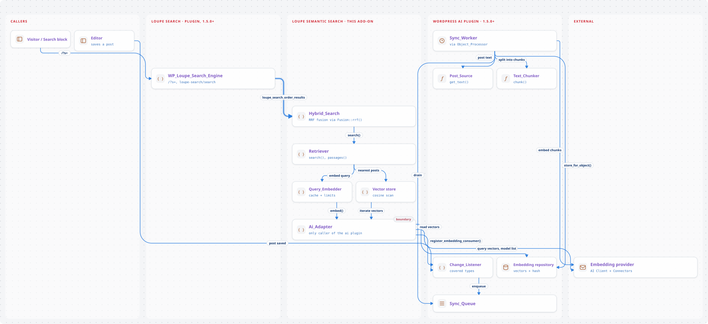

# Loupe Semantic Search — Design

Status: agreed design for v0.1.0, kept for its rationale. The current implementation is described in
[architecture.md](architecture.md), which takes precedence where the two differ.

## Purpose

Add semantic (vector) retrieval to [Loupe Search](https://github.com/soderlind/loupe-search):

1. **Hybrid site search.** Merge Loupe's keyword hits with vector-similarity hits for the
   front-end WordPress search and the REST `/search` endpoint (used by Loupe Search Block).
2. **RAG retrieval.** Expose abilities that return relevant passages with source URLs, so AI
   agents (for example through the MCP Adapter) can answer from site content and cite it.

## Identity

| Item | Value |
| --- | --- |
| Plugin name | Loupe Semantic Search |
| Slug / folder / text domain | `loupe-semantic-search` |
| Main file | `loupe-semantic-search.php` |
| Namespace | `Soderlind\Plugin\LoupeSemanticSearch` |
| Abilities | `loupe-semantic/retrieve`, `loupe-semantic/search` |
| Hook / option prefix | `loupe_semantic_` |
| Version | 0.1.0 |
| Requires | WordPress 7.0.3, PHP 8.3 |
| Requires Plugins | `loupe-search, ai` |
| License | GPL-2.0-or-later |

## Architecture

<picture>
  <source media="(prefers-color-scheme: dark)" srcset="diagrams/img/design-overview-dark.svg">
  
</picture>

Indexing runs in the `ai` plugin. When a post is saved, `Change_Listener` queues it if a registered
consumer covers its type. `Sync_Worker` then gets the post text, chunks it, has the provider embed
the chunks, and stores the vectors. The add-on only registers its consumer through `Ai_Adapter`.
At search time, Loupe's keyword hits reach `Hybrid_Search`. `Retriever` embeds the query, ranks
stored vectors, filters the matches and rebuilds passages, and the results are fused with RRF.

### Dependency on the `ai` plugin

WordPress 7 core ships Connectors and the AI Client, but no embedding API. The `ai` plugin
(1.5.0+) provides `generate_embeddings()` on top of the connectors and a complete sync pipeline.
Loupe Semantic Search does not implement its own queue, chunker, or vector storage.

All calls into the `ai` plugin and the AI Client live in one adapter class (`Ai_Adapter`). It
checks for the classes and functions it uses, not for a version number; if anything is missing the
add-on deactivates its features and shows an admin notice. Used surface:

- `WordPress\AI\supports_embedding_generation()`, `get_ai_connectors()`,
  `has_connector_authentication()`
- `WordPress\AI\register_embedding_consumer()` (before `init` priority 20)
- `Embedding_Sync::start_backfill()`, `cancel_backfill()`, `reset_backfill()`, `get_status()`,
  `prune_target()`, `instance()->get_repository()`, `instance()->get_registry()`
- `Embedding_Repository::iterate()` and the records' `get_content_hash()`
- `Post_Source::get_text()`, `Text_Chunker::chunk()`, `Object_Processor::hash_text()`
- AI Client: `EmbeddingBuilder` for query embeddings (with a request timeout), and
  `AiClient::defaultRegistry()->findProviderModelsMetadataForSupport()` for the model list
- Filters `wpai_embedding_sync_is_indexable`, `wpai_embedding_sync_max_chunks`

Cosine similarity is computed by the add-on (`Ai_Repository_Vector_Store::cosine()`), not by the
`ai` plugin.

## Provider and model

- The admin connects a provider under **Settings → Connectors** (WordPress 7). Without a
  connected provider that offers embedding models, the add-on is inactive and shows a notice
  linking to Connectors.
- The settings page lists only connected providers' models with the `embedding_generation`
  capability. The admin must choose one; nothing is selected automatically.
- The model list costs one HTTP request per provider. Since 0.1.1 it is saved in a transient for
  12 hours (5 minutes when a provider failed), keyed by the active connectors and whether each has
  credentials. An empty list is not saved, and a "Refresh model list" link fetches it again.
- Optional dimensions setting, passed through when the model supports it.
- Changing the model: register the consumer with the new target, start a backfill, and prune the
  old target's vectors once no other consumer uses it.

## Indexing

- Consumer ID `loupe-semantic-search`, objects `[ 'post' => <Loupe post types> ]`, where the post
  types come from `loupe_search_post_types` (via Loupe's utilities).
- Indexability follows Loupe. Loupe Search gets a public helper
  `loupe_search_is_post_indexable( WP_Post $post ): bool` wrapping its existing checks (post type,
  indexable statuses, password protection, `loupe_search_is_indexable`). We hook
  `wpai_embedding_sync_is_indexable` and veto a post that Loupe would not index.
  - The filter is shared by every `ai` consumer, so the veto only applies when no other consumer
    covers that post type. Otherwise the other consumer would lose content it needs.
- Text, chunking and hashing are the `ai` plugin's: title plus raw content as plain text
  (`the_content` is not applied), `Text_Chunker` defaults (750 characters, 125 overlap), and one
  content hash per post. Unchanged posts are not re-embedded.
- Backfill: started from the settings page, or with `wp ai embeddings sync backfill
  loupe-semantic-search`. Our WP-CLI command adds `status` and `query` (see below).

## Retrieval

### Vector search

- `Vector_Store` interface with a default `Ai_Repository_Vector_Store`. Selectable through the
  `loupe_semantic_vector_store` filter so a native vector backend can replace it later.
- Default store: iterate the model's vectors in batches of 200 with `Embedding_Repository::iterate()`,
  computing cosine similarity and keeping a running top-K. The `ai` table has no vector index,
  so this is a full scan; about 20,000 chunks is the documented practical limit.
- Keep the best chunk per post. Drop chunks below the minimum similarity (default 0.35).
- Query vectors are cached in a transient for 30 minutes, keyed by provider, model, dimensions
  and a hash of the normalised query.

### Passage text

Stored records contain vectors, not text. For the top hits only:

1. Rebuild the text with the `ai` plugin's post text source (same filter chain).
2. Compare `Object_Processor::hash_text()` with the stored hash.
3. If they match, chunk with `Text_Chunker`, apply the same max-chunks limit, and take the chunk
   at the stored `chunk_index`.
4. If they differ (content changed and not yet re-embedded), fall back to the post excerpt and
   mark the passage `stale: true`.

### Hybrid ranking

- Reciprocal rank fusion: `score = w_k / (60 + rank_keyword) + w_s / (60 + rank_semantic)`.
  Default weights 1.0 and 1.0, set in settings.
- Fallback to keyword-only when embedding the query fails, takes longer than 1.5 s, the rate
  limit or daily cap is hit, or no model is configured. Fallbacks never throw to the visitor.

### Where hybrid applies

| Surface | Hook | Default |
| --- | --- | --- |
| Front-end WordPress search | `loupe_search_order_results` (existing) | on |
| REST `/search` and Loupe Search Block | `loupe_search_advanced_hits` (new in Loupe Search) | on |
| Abilities | own registration | on once a model is chosen |

- A REST request can opt out with `semantic: false`.
- Hybrid is skipped when the request sorts explicitly by a field other than `_score`, or by geo
  distance: the caller asked for that order, not relevance. The front-end filter gets the applied
  field sort as its fourth argument for the same check.
- REST filters: semantic-only hits are kept only if the context's `matches_filter` callback
  returns them. Loupe runs the request's own filter string as an empty-query search, so every
  filter Loupe supports (taxonomies, custom fields, dates, geo) applies. Loupe caps that lookup at
  1000 matches; with a broader filter some semantic-only hits may be dropped, never wrongly added.
- Facet counts stay as Loupe computes them from keyword hits (known v1 limitation).
- Every semantic hit is checked with `loupe_search_is_post_indexable()` at query time, because
  bulk exclusion may change only post meta and the vector may still exist.
- Query operators: quotes, `-term` and `OR` are stripped before embedding. If the query contains
  an exclusion (`-term`), semantic ranking only reorders keyword hits and adds none, so excluded
  terms never come back through the semantic side.
- `loupe_search_order_results` runs before Loupe caches front-end results, so hybrid results are
  cached together with the keyword results. When the semantic side falls back, keyword-only
  results may be cached for the cache lifetime (accepted v1 limitation). REST keeps caching only
  Loupe's keyword results; fusion runs on every request.

## Abilities

Category `loupe-semantic`. Both default to `current_user_can( 'read' )`; the
`loupe_semantic_ability_permission` filter can open them up.

### `loupe-semantic/retrieve`

Input: `query` (required), `limit` (default 5, max 20), `post_type` (optional string or list).

Output:

```json
{
  "passages": [
    { "post_id": 12, "title": "…", "url": "…", "post_type": "post", "post_date": "…",
      "chunk_index": 2, "text": "…", "score": 0.71, "stale": false }
  ],
  "model": { "provider": "openai", "model": "text-embedding-3-small" }
}
```

### `loupe-semantic/search`

Same input and output shape as `loupe-search/search` (`hits`, `total_hits`, `page`,
`total_pages`), but hybrid ranked and limited to public post types.

## Limits and cost

- Per-IP rate limit for anonymous query embeddings: 30 per minute (`loupe_semantic_rate_limit`).
- Site-wide daily cap on embedding calls: 5,000 (setting, `loupe_semantic_daily_cap`).
- Cached query vectors do not count against either limit.
- Logged-in users with `manage_options` and WP-CLI are exempt from the per-IP limit.

## Settings page

**Settings → Loupe Search → Semantic search** tab (`manage_options`), added through Loupe Search's
`loupe_search_settings_tabs` filter. The old `?page=loupe-semantic-search` URL redirects to the tab.

- Provider and model picker, dimensions.
- Hybrid toggles per surface, keyword and semantic weights, minimum similarity.
- Rate limit and daily cap.
- Index status from `Embedding_Sync::get_status()`: coverage per post type, queue, backoff,
  provider errors, last run. Buttons: Start backfill, Cancel, Reset.

Option name: `loupe_semantic_settings` (single array, autoloaded).

## WP-CLI

`wp loupe-semantic`:

- `status`: settings, target model and index coverage.
- `query <text> [--limit=<n>] [--format=<format>]`: run a retrieval and print passages.
- `backfill [--reset]`: wrapper around the `ai` plugin's backfill for our consumer.

## Changes to Loupe Search

Released as Loupe Search 1.5.0.

1. Filter `loupe_search_advanced_hits( array $hits, string $query, array $context )` in the REST
   `POST /search` handler, after the merge-level sort and before pagination. Context keys:
   `post_types`, `filter`, `sort`, `payload`, `limit` and `matches_filter` (callable: post IDs in,
   IDs matching the request's filter out). Loupe drops added hits of unsearched post types, still
   runs the public-visibility check, and raises `totalHits` by the number of hits added.
2. `loupe_search_order_results` gains two arguments: the searched post types and the applied
   field sort (backwards compatible).
3. Public function `loupe_search_is_post_indexable( WP_Post|int $post ): bool`, backed by the static
   `WP_Loupe_Indexer::is_post_indexable()` (no Loupe instances are created).

## WordPress 7 requirement

`Requires at least: 7.0` in Loupe Search, Loupe Search Block, Loupe Cross-Site Search and
Loupe Admin Search, each with a minor version bump and changelog entry.

## Uninstall

- Delete `loupe_semantic_settings` and our transients.
- Prune our model's vectors with `Embedding_Sync::prune_target()` only if no other registered
  consumer uses the same provider and model.

## Project layout

```
loupe-semantic-search.php
includes/          PSR-4 classes (the plugin's own autoloader; Composer's is for tests only)
languages/         .pot and nb_NO translations
tests/php/         PHPUnit + Brain Monkey
docs/DESIGN.md, docs/architecture.md
README.md, readme.txt, CHANGELOG.md, uninstall.php
```

Repository: [soderlind/loupe-semantic-search](https://github.com/soderlind/loupe-semantic-search).

## Out of scope for v0.1.0

- Native vector index backends (sqlite-vec, MySQL 9 `VECTOR`, external stores).
- Recomputing facet counts for semantic-only hits.
- Cross-encoder reranking.
- Term embeddings.
