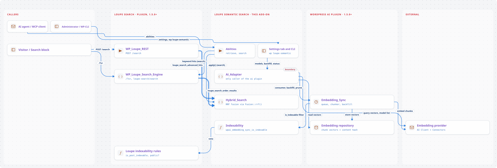
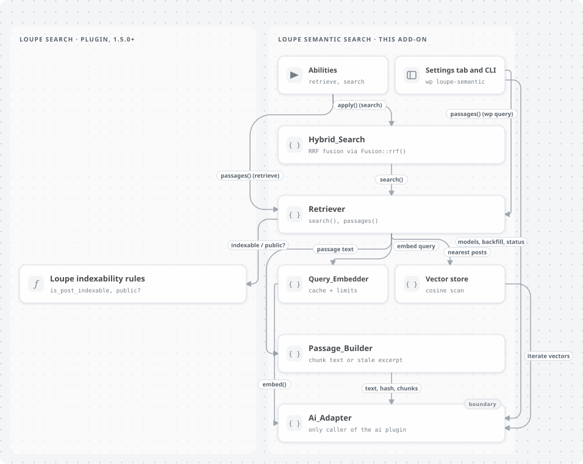

# Architecture

Current state as of version 0.1.1. The original design and its rationale are in
[DESIGN.md](DESIGN.md); where the two differ, this document describes the code.

## Purpose

Loupe Semantic Search adds meaning-based retrieval to [Loupe Search](https://github.com/soderlind/loupe-search):

1. **Hybrid search**: Loupe's keyword hits are fused with vector-similarity hits for the front-end
   search, the REST `/search` endpoint (used by Loupe Search Block) and the `loupe-search/search` ability.
2. **RAG retrieval**: abilities return relevant passages with source URLs, so an AI agent can answer
   from site content and cite it.

It is glue code. Embedding, chunking, the sync queue and vector storage belong to the WordPress
`ai` plugin (1.5.0+). Providers are connected under Settings → Connectors (WordPress 7).
Keyword search, indexability rules and result rendering belong to Loupe Search (1.5.0+).

Not included:

- A vector index. The default store scans every stored vector (see [Scale](#scale)).
- Its own embedding queue, chunker or vector table.
- Facet counts for semantic-only hits (Loupe computes facets from keyword hits only).
- Reranking with a cross-encoder, and term embeddings.

## System context

<picture>
  <source media="(prefers-color-scheme: dark)" srcset="diagrams/img/system-context-dark.svg">
  
</picture>

Calls into the `ai` plugin and the AI Client go through
[`Ai_Adapter`](../includes/Ai_Adapter.php). Calls into Loupe Search go through its public hooks,
`loupe_search_is_post_indexable()` and the `WP_Loupe_Utils`, `WP_Loupe_Search_Engine` and
`WP_Loupe_DB` classes.

Inside the add-on, `Retriever` reaches `Ai_Adapter` through `Query_Embedder`, the vector store and
`Passage_Builder`:

<picture>
  <source media="(prefers-color-scheme: dark)" srcset="diagrams/img/retrieval-components-dark.svg">
  
</picture>

The diagrams are generated from [diagrams/graph.json](diagrams/graph.json); see
[diagrams/README.md](diagrams/README.md) to change them.

## Components

| Component | Responsibility | Implementation | Depends on |
| --- | --- | --- | --- |
| Bootstrap | Autoloader, boot on `plugins_loaded` 20 (after Loupe) | [loupe-semantic-search.php](../loupe-semantic-search.php) | — |
| `Plugin` | Service wiring, readiness check, consumer registration, model-change handling, setup notices | [includes/Plugin.php](../includes/Plugin.php) | everything below |
| `Ai_Adapter` | The only caller of the `ai` plugin and AI Client: availability, model list, query embedding, consumer, backfill, vector iteration, text/hash/chunks | [includes/Ai_Adapter.php](../includes/Ai_Adapter.php) | `ai` plugin |
| `Settings` | Read, default and sanitize the `loupe_semantic_settings` option | [includes/Settings.php](../includes/Settings.php) | — |
| `Indexability` | Veto embedding of posts Loupe would not index | [includes/Indexability.php](../includes/Indexability.php) | `Ai_Adapter`, Loupe |
| `Query_Embedder` | Normalize the query, cache the vector, apply limits and timeout | [includes/Query_Embedder.php](../includes/Query_Embedder.php) | `Ai_Adapter`, `Rate_Limiter` |
| `Rate_Limiter` | Per-IP per-minute limit and site-wide daily cap on uncached query embeddings | [includes/Rate_Limiter.php](../includes/Rate_Limiter.php) | `Settings` |
| `Vector_Store` | Interface: nearest posts for a vector, best chunk per post | [includes/Vector_Store.php](../includes/Vector_Store.php) | — |
| `Ai_Repository_Vector_Store` | Default store: full cosine scan of the `ai` plugin's vectors | [includes/Ai_Repository_Vector_Store.php](../includes/Ai_Repository_Vector_Store.php) | `Ai_Adapter` |
| `Retriever` | Query → vector → nearest posts (Loupe-indexable only) → passages | [includes/Retriever.php](../includes/Retriever.php) | `Query_Embedder`, `Vector_Store`, `Passage_Builder`, Loupe |
| `Passage_Builder` | Rebuild a matched chunk's text, or a stale excerpt | [includes/Passage_Builder.php](../includes/Passage_Builder.php) | `Ai_Adapter` |
| `Fusion` | Reciprocal rank fusion of two ID rankings | [includes/Fusion.php](../includes/Fusion.php) | — |
| `Hybrid_Search` | Loupe filter callbacks; fuse keyword and semantic hits, fall back to keyword hits | [includes/Hybrid_Search.php](../includes/Hybrid_Search.php) | `Retriever`, `Fusion`, `Settings` |
| `Abilities` | `loupe-semantic/retrieve` and `loupe-semantic/search` | [includes/Abilities.php](../includes/Abilities.php) | `Retriever`, `Hybrid_Search`, Loupe |
| `Admin\Settings_Page` | Semantic search tab in Settings → Loupe Search, admin-post handlers | [includes/Admin/Settings_Page.php](../includes/Admin/Settings_Page.php) | `Ai_Adapter`, `Rate_Limiter`, `Settings` |
| `CLI\Command` | `wp loupe-semantic status|query|backfill` | [includes/CLI/Command.php](../includes/CLI/Command.php) | `Plugin` services |
| Uninstall | Delete options and transients; prune vectors unless shared | [uninstall.php](../uninstall.php) | `ai` plugin |

Dependency rules:

- Only `Ai_Adapter` (and `uninstall.php`, which runs without the plugin loaded) may reference
  `WordPress\AI\…` or `WordPress\AiClient\…`. A change in the `ai` plugin's API should touch one file.
- `Fusion` and `Settings` are pure helpers and must not depend on other components.
- Services are built by `Plugin` and passed to constructors; only `CLI\Command` reaches back
  through `Plugin::instance()`.

## Boot sequence

1. `plugins_loaded` 20: `Plugin::boot()`.
   - In admin, `Admin\Settings_Page` and setup notices are registered, even when the add-on is not ready.
   - `Plugin::is_ready()` requires Loupe's `loupe_search_is_post_indexable()` and
     `Ai_Adapter::is_available()` (the `ai` plugin's embedding functions and classes exist).
     Neither checks a version number. If not ready, nothing else is hooked.
   - `Indexability` and `Hybrid_Search` register their filters.
   - `Abilities` registers only when the `abilities` setting is on **and** a model is saved.
   - `CLI\Command` registers under WP-CLI.
2. `init` 15: `Plugin::register_consumer()` registers the embedding consumer `loupe-semantic-search`
   for the saved target and Loupe's indexed post types. It must run after post types exist and
   before the `ai` plugin's sync at `init` 20.
3. `init` 30: `Plugin::apply_target_change()` finishes a model change (see [Model change](#model-change)).

## Flows

### Indexing (owned by the `ai` plugin)

1. A post is saved; the `ai` plugin's sync queues it for every consumer covering its post type.
2. The `ai` plugin asks `wpai_embedding_sync_is_indexable`. `Indexability::filter()` returns
   `loupe_search_is_post_indexable()` **only** if this add-on's consumer covers the post type and no
   other consumer does; otherwise it leaves the value unchanged.
3. The `ai` plugin builds the text (title + raw content), chunks it (750 characters, 125 overlap,
   at most 50 chunks, filter `wpai_embedding_sync_max_chunks`), embeds each chunk and stores the vectors with a content hash.
   Unchanged posts (same hash) are skipped.

A backfill is started from the settings tab, by `wp loupe-semantic backfill`, or after a model change.

### Front-end search (`/?s=`) and `loupe-search/search`

1. Loupe's `WP_Loupe_Search_Engine::search()` merges keyword hits and applies
   `loupe_search_order_results( $hits, $query, $post_types, $sort )`.
2. `Hybrid_Search::filter_order_results()` returns the hits unchanged when the `hybrid_frontend`
   setting is off, a field sort is applied, or the hits are already fused (`_hybrid` flag).
3. `Hybrid_Search::hybridize()` asks `Retriever::search()` for `loupe_semantic_candidates` matches (default 50).
4. `Retriever::search()`:
   1. `Query_Embedder::embed()` strips Loupe operators (quotes, `-term`, `OR`) and lowercases the query.
      It returns a cached vector from the `loupe_semantic_qv_*` transient (30 minutes), or takes a
      `Rate_Limiter` slot and calls `Ai_Adapter::embed()` with a 1.5 s timeout.
   2. The `Vector_Store` (default `Ai_Repository_Vector_Store`) scans the target model's vectors, keeps
      the best chunk per post above `min_similarity` (default 0.35), and returns `3 × limit + 10` matches.
   3. Each match is kept only if its post type was searched and `loupe_search_is_post_indexable()` is true.
5. `Hybrid_Search::merge()` fuses keyword ranks and semantic ranks with `Fusion::rrf()`
   (`w_k / (60 + rank_k) + w_s / (60 + rank_s)`, weights from settings). If the query has an exclusion
   (`-term`), semantic matches only reorder keyword hits; none are added.
   Every hit gets `_score` (fused), `_hybrid`, and `_keywordScore` / `_semantic` when available.
6. Loupe caches the returned hits in its own transient, so the fused list is cached with them.

<picture>
  <source media="(prefers-color-scheme: dark)" srcset="diagrams/img/hybrid-search-view-dark.svg">
  
</picture>

When the semantic side fails, the keyword hits pass through unchanged (see [Failure behavior](#failure-behavior)):

<picture>
  <source media="(prefers-color-scheme: dark)" srcset="diagrams/img/hybrid-fallback-view-dark.svg">
  
</picture>

### REST `POST /search` (Loupe Search Block)

1. `WP_Loupe_REST` applies `loupe_search_advanced_hits( $hits, $query, $context )` after its sort
   and before pagination. `$context` carries `post_types`, `filter`, `sort`, `payload`, `limit` and
   the callable `matches_filter`.
2. `Hybrid_Search::filter_advanced_hits()` skips when `hybrid_rest` is off, the payload has
   `semantic: false`, or the sort is not relevance (`Hybrid_Search::is_relevance_sort()`).
3. As in the front-end flow, plus: when the request has a filter, semantic-only IDs are passed to
   `matches_filter` and dropped unless Loupe says they match the filter.
4. Loupe drops hits of unsearched post types, raises `totalHits` by the hits added, paginates, and
   drops posts that are not publicly viewable. Fusion runs on every request; Loupe caches only its keyword hits.

### Ability `loupe-semantic/retrieve` (RAG)

1. `Abilities::can_use()` allows users who can `read` (filter `loupe_semantic_ability_permission`).
2. `Abilities::execute_retrieve()` limits post types to Loupe's public indexed types and `limit` to 1–20.
3. `Retriever::passages()` runs `search()` with `public_only` (drops posts not publicly viewable), then
   `Passage_Builder::build()` for each match:
   - If the post's current text hashes to the stored hash, the chunk at `chunk_index` is returned.
   - Otherwise (post edited, not yet re-embedded) a plain excerpt is returned with `stale: true`.
4. Returns `passages` (post ID, title, URL, type, date, chunk index, text, rounded score, stale) and `model`.

<picture>
  <source media="(prefers-color-scheme: dark)" srcset="diagrams/img/rag-retrieve-view-dark.svg">
  
</picture>

`loupe-semantic/search` runs Loupe's `WP_Loupe_Search_Engine` directly, then
`Hybrid_Search::apply()` (ignoring the surface toggles), filters to publicly viewable posts and paginates.
`wp loupe-semantic query` calls `Retriever::passages()` like the retrieve ability.

### Model change

1. The settings form saves `target` as `provider::model`; `Settings::sanitize()` splits it.
2. `Plugin::on_settings_updated()` (or `on_settings_added()` on first save) compares
   provider, model and dimensions. On a change it stores the **old** provider and model in the
   `loupe_semantic_target_change` option.
3. On the next request, `init` 15 registers the consumer with the new target.
4. `init` 30, `Plugin::apply_target_change()`: deletes the option, starts a backfill and, if the provider
   or model changed and no other consumer uses the old one, prunes the old model's vectors
   (`Ai_Adapter::prune()`). A dimensions-only change re-embeds on hash mismatch and prunes nothing.

### Settings tab model list

`Admin\Settings_Page::render_model_select()` calls `Ai_Adapter::embedding_models()`, which asks each
connector's provider for models with the `embedding_generation` capability. Listing is one HTTP
request per provider, so the result is saved in the `loupe_semantic_models_<md5>` transient:

- The key hashes each active connector and whether it has credentials, so connecting or disconnecting a
  provider uses a new key.
- 12 hours when every provider answered; 5 minutes when one threw, so it is asked again soon.
- An empty result deletes the saved list instead of saving it.
- The **Refresh model list** link (`admin-post.php?action=loupe_semantic_refresh_models`) fetches again.

## Persistence

| Data | Store | Owner | Lifetime |
| --- | --- | --- | --- |
| Settings | option `loupe_semantic_settings` | `Settings` | until uninstall |
| Pending model change | option `loupe_semantic_target_change` (not autoloaded) | `Plugin` | until the next `init` 30 |
| Daily embedding count | option `loupe_semantic_daily_usage` (not autoloaded) | `Rate_Limiter` | resets on a new day (site time) |
| Query vectors | transient `loupe_semantic_qv_<md5(target, query)>` | `Query_Embedder` | 30 min (`loupe_semantic_query_cache_ttl`) |
| Per-IP counters | transient `loupe_semantic_rl_<md5(ip)>_<minute>` | `Rate_Limiter` | 60 s |
| Model list | transient `loupe_semantic_models_<md5(connectors)>` | `Ai_Adapter` | 12 h, or 5 min after a provider failure |
| Chunk vectors and content hashes | the `ai` plugin's embeddings table | `ai` plugin | until pruned or the post is removed |
| Sync queue and backfill state | the `ai` plugin | `ai` plugin | — |

The add-on stores no passage text; it is rebuilt from the post at query time.
Settings and transients are per site on multisite.

## Failure behavior

Search never fails because of the semantic side. Every error in `Hybrid_Search::hybridize()` returns
the keyword hits unchanged.

| Failure | Behavior |
| --- | --- |
| No model saved, empty query after normalization, no post types | Keyword hits unchanged; `Retriever::search()` returns `WP_Error` `loupe_semantic_no_model` for abilities and CLI |
| Rate limit or daily cap reached | `WP_Error` `loupe_semantic_rate_limited`; keyword hits unchanged |
| Provider error or timeout (1.5 s) | `WP_Error` `loupe_semantic_embedding_failed`; not cached; keyword hits unchanged |
| `matches_filter` throws | Keyword hits unchanged |
| Post edited since embedding | Passage is an excerpt with `stale: true` |
| Stored vector has other dimensions than the query | Cosine score 0, so it is dropped by `min_similarity` |
| A provider fails while listing models | Other providers' models are shown; list saved for 5 minutes |
| `ai` plugin or Loupe missing | Admin notice; no hooks besides the settings tab |

There are no retries in the add-on. Embedding retries and backoff during indexing belong to the `ai` plugin.

## Invariants

| Rule | Enforced by | Verified by |
| --- | --- | --- |
| A post Loupe would not index is never returned, even if its vector still exists | `Retriever::search()` checks `loupe_search_is_post_indexable()`; `Indexability::filter()` stops new embeddings | `IndexabilityTest`; acceptance AC-14 |
| Abilities and CLI passages return only publicly viewable posts | `Retriever::passages()` with `public_only`; `Abilities::execute_search()` | `RetrieverTest` |
| The veto never removes content another `ai` consumer needs | `Indexability::filter()` skips post types covered by another consumer | `IndexabilityTest::test_leaves_shared_post_types_to_other_consumers` |
| A query with `-term` never gains hits from the semantic side | `Query_Embedder::has_exclusion()` → `merge( …, $rerank_only )` | `Hybrid_SearchTest::test_merge_rerank_only_adds_nothing`, `test_rest_exclusion_query_reranks_only` |
| Explicit field sorts and `semantic: false` keep Loupe's order | `filter_order_results()` / `filter_advanced_hits()` guards | `Hybrid_SearchTest::test_front_end_skips_field_sorts_and_disabled_toggle`, `test_rest_skips_on_opt_out_and_on_non_relevance_sort`; AC-09, AC-10 |
| REST semantic-only hits respect the request filter | `matches_filter` in `hybridize()` | `Hybrid_SearchTest::test_rest_drops_semantic_only_hits_outside_the_filter` |
| Hits are fused at most once per request | `_hybrid` flag, `already_hybrid()` | `Hybrid_SearchTest::test_already_fused_hits_are_left_alone` |
| Only uncached query embeddings count against limits; administrators and WP-CLI skip the per-IP limit, never the daily cap | `Query_Embedder::embed()` checks the cache first; `Rate_Limiter::is_exempt()` | `Query_EmbedderTest`, `Rate_LimiterTest` |
| Old vectors are pruned only when no other consumer uses that provider and model | `Plugin::apply_target_change()`, `uninstall.php` via `other_consumer_uses()` | `PluginTest` (`uninstall.php` is not covered) |
| A failed or empty model listing is never saved for 12 hours | `Ai_Adapter::embedding_models()` | `Ai_AdapterTest` |

`Rate_Limiter` counts with read-then-write option and transient updates without a lock, so
concurrent requests can exceed a limit slightly.

## Scale

`Ai_Repository_Vector_Store` reads every vector of the target model in batches of 200 and computes
cosine similarity in PHP on each uncached search. It is practical up to about 20,000 chunks. A faster
backend can replace it through the `loupe_semantic_vector_store` filter by returning a `Vector_Store`.

## Where to make changes

| Change | Primary location | Also update |
| --- | --- | --- |
| Adapt to an `ai` plugin or AI Client API change | `Ai_Adapter` | `uninstall.php` if it uses the same API; `tests/php/Ai_AdapterTest.php` |
| New vector backend | New `Vector_Store` class, returned from `loupe_semantic_vector_store` | `README.md` Filters |
| Change the ranking formula or weights | `Fusion::rrf()`, `Hybrid_Search::merge()` | `FusionTest`, `Hybrid_SearchTest`, acceptance AC-03 to AC-07 |
| Hybrid on a new Loupe surface | Loupe hook + `Hybrid_Search` callback, toggle in `Settings::defaults()` / `sanitize()` and the settings tab | `Hybrid_SearchTest`, `SettingsTest`, translations |
| New setting | `Settings::defaults()`, `Settings::sanitize()`, `Admin\Settings_Page::render()` | `SettingsTest`, `languages/`, `README.md` |
| New ability or ability field | `Abilities::register_abilities()` and its execute callback | `README.md` Abilities, acceptance J4 |
| Query limits or caching | `Rate_Limiter`, `Query_Embedder` | `Rate_LimiterTest`, `Query_EmbedderTest` |
| New CLI subcommand | `CLI\Command` | `README.md` WP-CLI |
| New stored option or transient | Owner class | `uninstall.php` (transients with prefix `loupe_semantic_` are deleted automatically) |

User-facing strings use the `loupe-semantic-search` text domain. Regenerate `languages/` with
`wp i18n make-pot`, `update-po`, `make-mo` and `make-php` after changing them.

## Tests

- Unit tests (PHPUnit + Brain Monkey, no WordPress): `composer test` or `vendor/bin/phpunit`, in `tests/php/`.
- Acceptance tests (Playwright against a running local site with a real provider):
  `npm run test:acceptance`. The criteria are in [tests/acceptance/CRITERIA.md](../tests/acceptance/CRITERIA.md).
